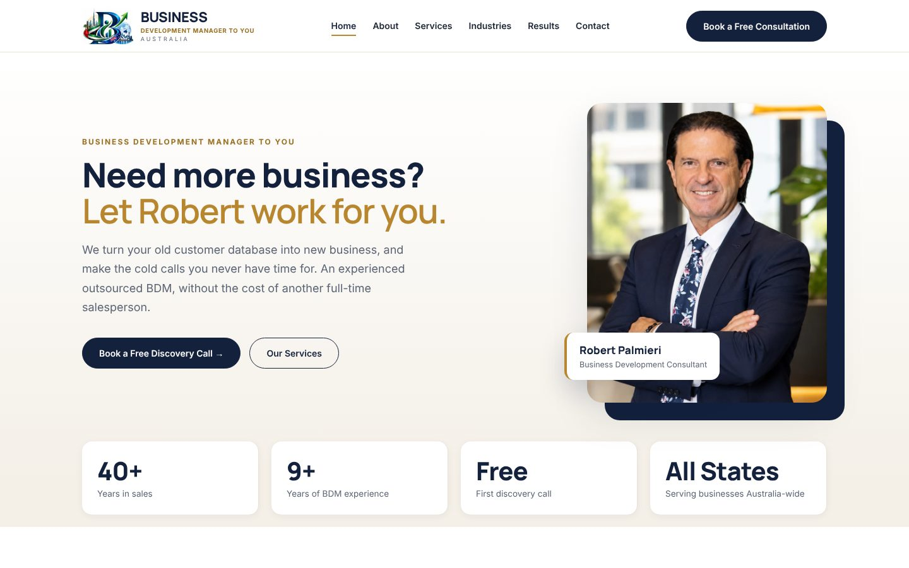
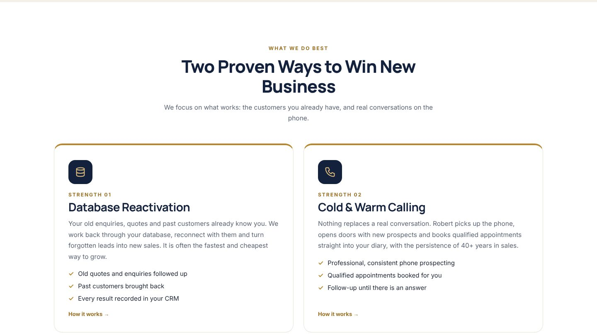
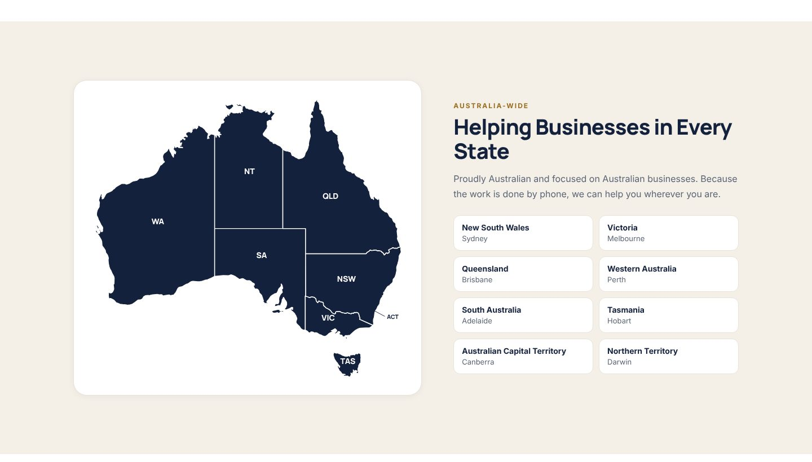
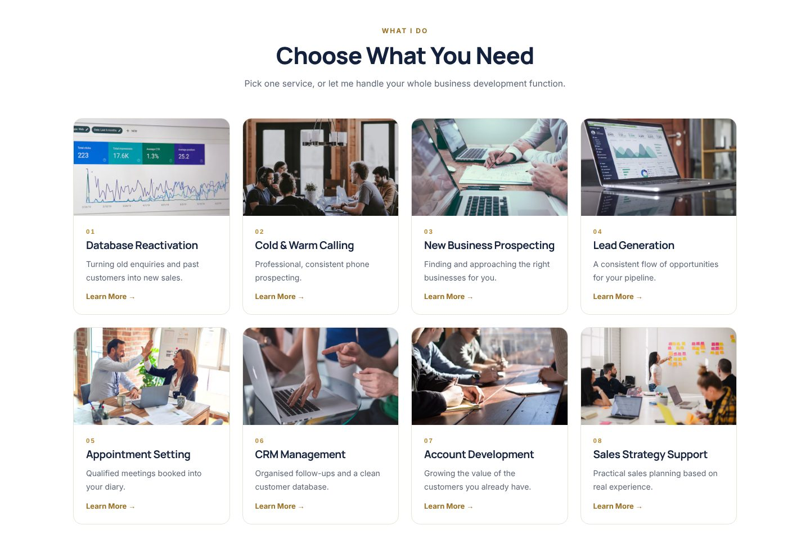
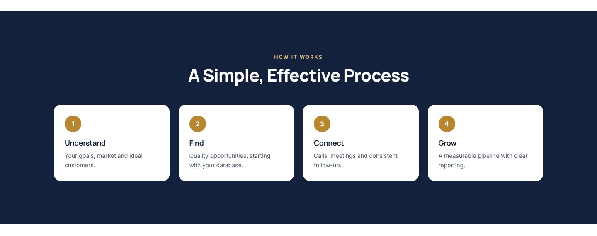
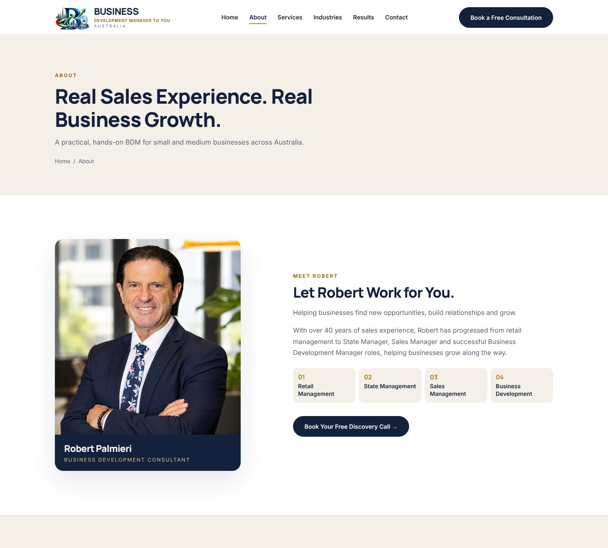
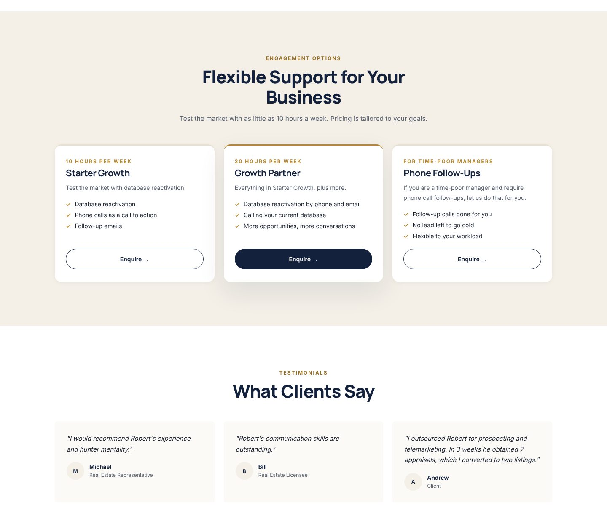
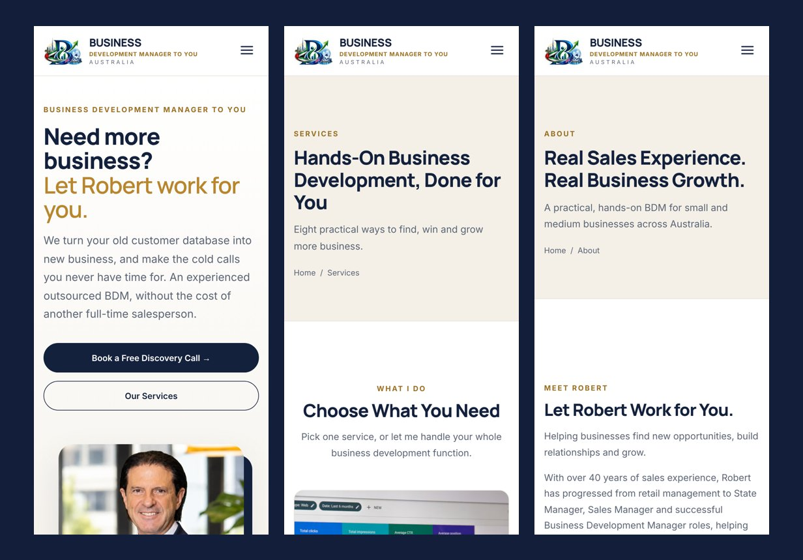

# 📞 BDM To You: Website Showcase

**A website I am designing and building for BDM To You, an Australia-wide outsourced Business Development Manager service for small and medium businesses.**

<picture></picture>
<picture></picture>

<picture></picture>
<picture></picture>
<picture></picture>
<picture></picture>

---

## 📌 About the project

BDM To You is run by **Robert Palmieri**, a business development consultant with over 40 years in sales and 9+ years as a Business Development Manager. He works as an outsourced BDM for small and medium businesses anywhere in Australia, mainly through **database reactivation** (turning old enquiries, quotes and past customers into new sales) and **cold & warm calling**.

The client wanted a clean, professional site that builds trust and turns visitors into booked calls. The site needed to:

- explain clearly what an outsourced BDM does and why it costs less than hiring a full-time salesperson
- present Robert's experience and results
- show that he serves businesses in every Australian state
- make it easy to book a free consultation

I am responsible for the whole build: **design, development, content structure, SEO and deployment**.

---

## ✨ Features

| Area | What I built |
|---|---|
| 🎨 **Brand & design** | A clean, corporate look in navy, warm beige and gold, with modern typography and a strong "Book a Free Consultation" call to action on every page |
| 🏠 **Home page** | A hero section with Robert's portrait, trust stats (40+ years in sales, 9+ years as a BDM, free first call, all states), the two core strengths, a process section and calls to action |
| 🗺️ **Australia-wide map** | An SVG map of Australia showing every state and territory served, with the capital city for each |
| 🧰 **Services** | Eight service cards (database reactivation, cold & warm calling, new business prospecting, lead generation, appointment setting, CRM management, account development, sales strategy), each with its own detailed section |
| 🏭 **Industries** | The types of business-to-business companies Robert works with |
| 📈 **Results** | Real results, flexible engagement packages and client testimonials |
| 👤 **About** | Robert's background, his career path and five reasons businesses work with him |
| ✉️ **Contact** | A consultation booking form (Netlify Forms), direct contact details and an FAQ |
| 📱 **Responsive** | Mobile-first layouts with a slide-out menu, tested on phones, tablets and desktop |
| 🔍 **SEO** | Clear page titles and meta descriptions on every page |

---

## 🖼️ Screenshots

### Home

### Two proven ways to win new business

### Helping businesses in every state

### Services

### A simple, effective process

### About: meet Robert

### Packages & testimonials

### Mobile

---

## 🛠️ Tech stack

- **Frontend:** semantic HTML5, modern CSS (custom properties, Flexbox and Grid), vanilla JavaScript
- **Graphics:** inline SVG map of Australia, optimised WebP photos
- **Hosting:** Netlify, with the source kept in a private GitHub repository
- **Forms:** Netlify Forms for consultation requests

---

## 🧭 My process

1. **Discovery:** learned about Robert's services, experience and ideal clients.
2. **Structure:** planned six pages that lead visitors from "what is an outsourced BDM?" to booking a call.
3. **Design:** created a clean, trustworthy corporate look with clear calls to action.
4. **Build:** produced a lightweight static site with no framework overhead, so pages load fast.
5. **Iteration:** working through rounds of client feedback on content and layout.
6. **Launch:** final contact details, domain and Google setup still to come.

---

## 🚧 Status

**In progress.** All six pages are built and the site is going through client review before launch.

---

## 🔒 Why there's no source code here

> [!IMPORTANT]
> **This is a showcase repository. It contains only screenshots and this write-up.**
>
> BDM To You is a **real client project**. The client owns the source code, and it is kept in a **private repository** because it contains:
> - the client's business content, photos and branding assets
> - configuration used by the site (forms, deployment)
> - the client's contact details
>
> Making that repository public would expose the client's data, so I keep it private. This repo explains what I built and how.

---

## 👨‍💻 Author

**Jamshaid Khan Niazi**, web developer

- 🌐 Portfolio: [jamshaidkhanniazi5965-ship-it.github.io](https://jamshaidkhanniazi5965-ship-it.github.io)
- 💼 GitHub: [@jamshaidkhanniazi5965-ship-it](https://github.com/jamshaidkhanniazi5965-ship-it)

---

© BDM To You. The brand, logo, photos and content belong to the client and are shown here for portfolio purposes only. The source code is not included.

